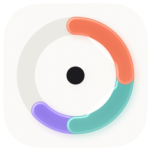

  

<h1 align="center">Lapso</h1>

A focus timer for iPhone, for the things you keep putting off.

Lapso helps you stop waiting and start doing. Pick what the session is for, press Start and give it 25 minutes, nothing else. Every finished session counts, so you can see the work you got done.

This repository holds the website for the app:

- [Home](https://aleksanderlebedenko.github.io/lapso/)
- [Privacy Policy](https://aleksanderlebedenko.github.io/lapso/privacy.html)
- [Terms of Use](https://aleksanderlebedenko.github.io/lapso/terms.html)
- [Support](https://aleksanderlebedenko.github.io/lapso/support.html)

The source code of the app is not in this repository.

Questions and feedback: see the [support page](https://aleksanderlebedenko.github.io/lapso/support.html).

© 2026 Oleksandr Lebedenko. All rights reserved.
